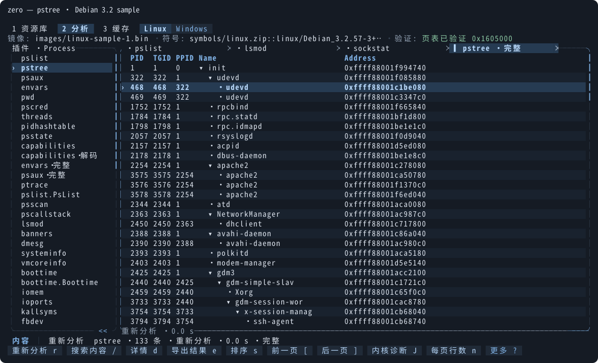
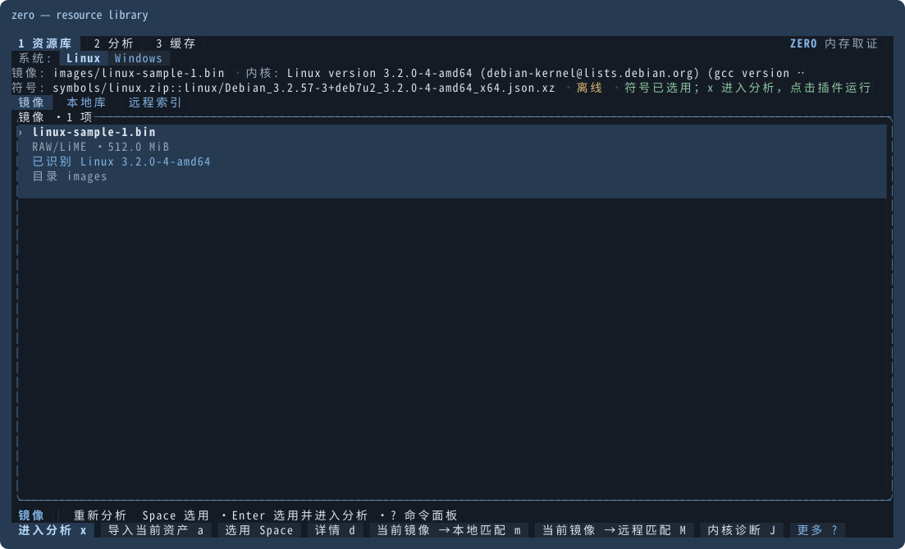
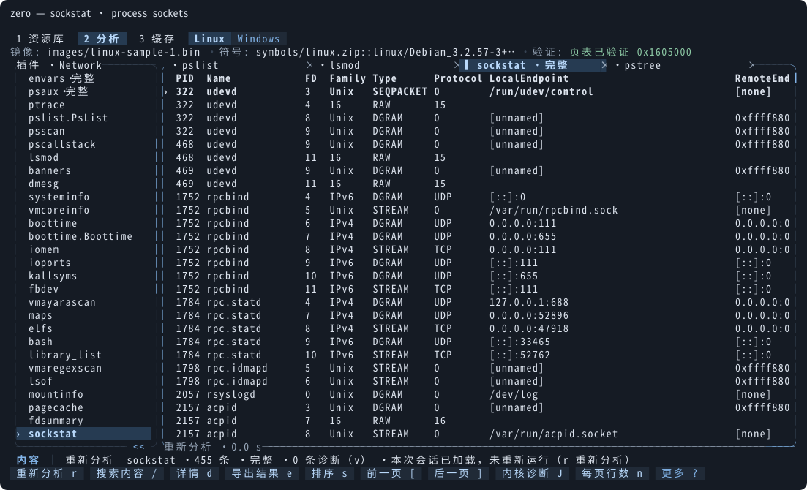
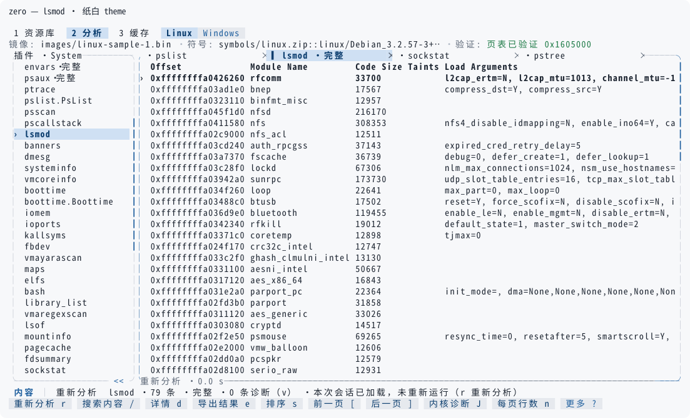
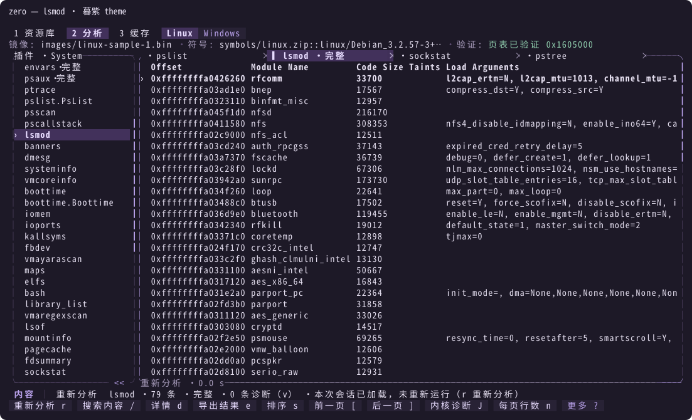
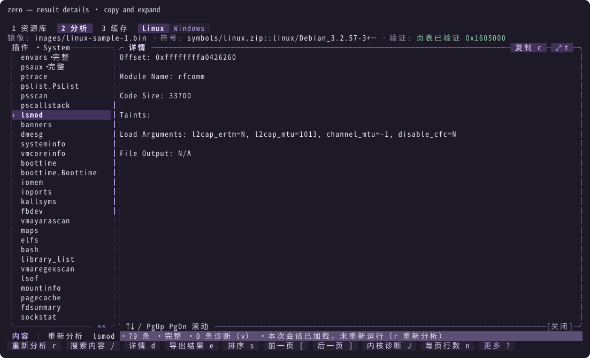
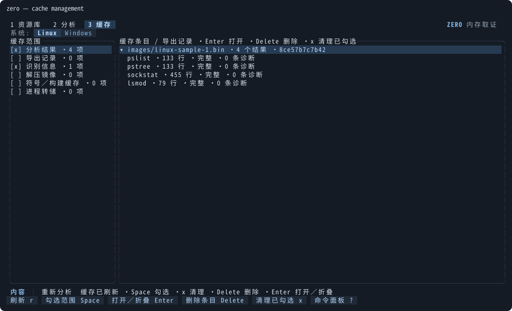

<div align="center">

# Zero

**本地内存取证工作台，原生 Rust 实现。**

Linux / Windows 镜像 · 精确符号匹配 · TUI / CLI / MCP

[](https://github.com/sunmedalia/zero/actions/workflows/ci.yml)
[](https://github.com/sunmedalia/zero/releases/latest)


[下载](https://github.com/sunmedalia/zero/releases/latest) · [快速开始](#快速开始) · [使用指南](docs/usage.md) · [兼容矩阵](docs/compatibility.md) · [MCP](docs/mcp.md)



</div>

Zero 从本地内存镜像恢复进程、模块、文件、网络连接与内核完整性信息。一个可执行文件提供可用鼠标操作的终端界面、适合脚本的命令行，以及供 AI 工具调用的 stdio MCP 服务。运行分析无需 Python、Volatility、Node 或 HTTP 服务。

## 为什么使用 Zero

| 能力 | 行为 |
| --- | --- |
| 精确符号匹配 | Linux 按完整内核 banner 匹配 ISF；Windows 按 PDB GUID / Age 匹配。找不到精确符号时明确提示，不使用相近版本替代。 |
| 保留分析边界 | 缺页、布局未验证、对象损坏时保留部分结果和诊断，并与完整结果分别缓存。部分结果中的未命中不能作为排除依据。 |
| 证据只读 | 镜像以只读方式打开；移除资源只更新项目清单。在线模式查询与下载符号，不上传镜像；`--offline` 禁止网络请求。 |
| Linux 与 Windows | 167 个注册插件入口：Linux 66 个、Windows 101 个，包含转储及兼容入口。覆盖进程、内存映射、socket、注册表、模式搜索和内核异常线索。 |
| 交互与自动化 | 结果标签、筛选、排序、进程树、滚动条、命令面板；CLI 导出 CSV / JSON，MCP 支持结果快照分页与取消。 |

## 安装

从 [Releases](https://github.com/sunmedalia/zero/releases/latest) 下载对应平台归档和 `SHA256SUMS`。解压后直接运行 `zero`，无需安装界面依赖。

| 宿主平台 | 归档名称中的目标 |
| --- | --- |
| Linux x86_64 | `x86_64-unknown-linux-gnu` |
| Linux ARM64 | `aarch64-unknown-linux-gnu` |
| macOS Apple Silicon | `aarch64-apple-darwin` |

Linux 发布包在 Ubuntu 24.04 上构建，需要兼容的 glibc。宿主平台与被分析镜像的系统是两个不同维度，镜像覆盖情况见[兼容矩阵](docs/compatibility.md)。

符号下载与包解压均使用内置实现。自动准备 Kali 符号时仍需 `git` 和 `go`，可运行 `zero doctor` 检查。

以 Linux x86_64 的 v0.2.5 为例，在下载目录执行：

```sh
sha256sum --check --ignore-missing SHA256SUMS
tar xzf zero-0.2.5-x86_64-unknown-linux-gnu.tar.gz
cd zero-0.2.5-x86_64-unknown-linux-gnu
./zero
```

macOS 可用 `shasum -a 256 <归档文件名>` 计算摘要，与 `SHA256SUMS` 中对应文件的摘要核对，再解压运行。

<details>
<summary>从源码构建</summary>

安装仓库 [rust-toolchain.toml](rust-toolchain.toml) 指定的 Rust 工具链后：

```sh
cargo build --release --locked
./target/release/zero
```

构建依赖、检查与发布流程见[开发说明](docs/development.md)。

</details>

## 快速开始

### 在终端中完成第一次分析

```sh
# 进入资源库
zero

# 或直接打开指定镜像的分析工作台
zero --image images/memory.raw --symbols symbols/kernel.json.xz
```

1. 在资源库的“镜像”页导入文件，用 Space 选用，或按 Enter 选用并准备进入分析。
2. Zero 校验镜像、识别 Linux / Windows 内核并匹配本地精确符号。缺少符号时可按 `M` 在线匹配；也可导入已有 ISF。
3. 准备完成后进入分析页，点击插件或按 Enter 运行。结果底边标明缓存读取或重新分析；`v` 查看诊断，`d` 查看当前行详情。

首次进入空的分析页，也可点击“打开资源库 · 镜像”直接定位镜像列表。镜像和符号文件需自行准备，发布包不附带样本。

### 用于脚本和 AI 工具

```sh
# 离线分析，导出 JSON
zero --offline analyze --image /evidence/memory.raw \
  --symbols /evidence/kernel.json.xz --plugin pslist --output exports/processes.json

# 识别内核，下载精确匹配的符号
zero symbols --image /evidence/memory.raw --download

# 转储指定进程，生成包含 SHA256 的清单
zero dump --image /evidence/memory.raw --symbols /evidence/kernel.json.xz \
  --mode process --pid 1 --dump-dir exports/dumps --output exports/dump-index.csv

# 启动 stdio MCP 服务
zero mcp
```

完整参数见 `zero --help` 与各子命令的 `--help`；MCP 配置和调用示例见 [MCP 文档](docs/mcp.md)。

## 终端界面

底部操作栏始终保持一行：宽屏完整展示，窄屏优先保留常用操作，其余收进“更多”。插件列表可收起，结果与详情都可作为独立标签页查看。

| 操作 | 快捷键 / 按钮 |
| --- | --- |
| 切换资源库、分析、缓存 | `1` / `2` / `3` |
| 搜索当前区域 / 命令面板 | `/` / `?` 或 Ctrl+P |
| 查看分析诊断 / 当前行详情 | `v` / `d` |
| 复制详情全文 / 展开为标签页 | `c` / 右上角 `⤢` 或 `t` |
| 切换 / 关闭结果标签 | Ctrl+PgUp、Ctrl+PgDn / Ctrl+W |
| 收起 / 展开插件列表 | `<<` / 左下角 `>>`，或 `B` |
| 设置与主题 / 全部快捷键 | `,` / `H` |
| 退出 | `q` 弹窗确认，Enter 确认、Esc 取消；Ctrl+C 立即退出 |

提供石板、纸白、Solarized、荧光绿、高对比、暮紫六套主题，以及跟随终端背景的自动主题。所有弹窗使用当前主题配色。详情复制优先使用系统剪贴板，远程会话回退到需要终端支持的 OSC 52。

<table>
  <tr>
    <td width="50%"><br><sub><b>资源库</b> · 管理镜像、本地符号与远程索引</sub></td>
    <td width="50%"><br><sub><b>网络线索</b> · 查看进程 FD 引用的 socket</sub></td>
  </tr>
  <tr>
    <td width="50%"><br><sub><b>纸白主题</b> · 浅色终端中的模块分析</sub></td>
    <td width="50%"><br><sub><b>暮紫主题</b> · 柔和的深色工作台</sub></td>
  </tr>
  <tr>
    <td width="50%"><br><sub><b>结果详情</b> · 复制文本或展开为独立标签页</sub></td>
    <td width="50%"><br><sub><b>缓存管理</b> · 分组清理与导出记录回看</sub></td>
  </tr>
</table>

<sub>截图通过 <code>make screenshots</code> 分析本地公开 Debian 3.2 样本生成，使用实际 TUI 状态机与终端 Buffer。</sub>

## 支持范围与验证

| 项目 | 范围 |
| --- | --- |
| 镜像格式 | RAW、LiME（含未压缩 AVML 输出）、Windows crash dump / minidump、已识别布局的休眠文件、gzip 压缩镜像 |
| 符号格式 | ISF JSON、JSON.XZ、ZIP 成员；Windows 可下载精确 PDB 并在本地转换 |
| Linux | x86_64 四级页表（含 KASLR）、ARM64 4 KiB 页（39 / 48-bit VA）；已验收 Debian 3.2 与 Kali 6.8.11 ARM64 |
| Windows | 按精确 PDB 匹配；Microsoft 返回 404 时，可从 Volatility 官方符号包按需获取精确 ISF。逐插件、逐样本证据见[兼容矩阵](docs/compatibility.md)。 |
| 符号来源 | 本地文件、[volatility3-symbols](https://github.com/Abyss-W4tcher/volatility3-symbols)、Microsoft 符号服务器；Kali ARM64 可从官方调试包生成 |

休眠文件与压缩 store 的部分路径只有合成验证。Linux32 / PAE 页表与 ELF32 已有内部参考测试，公开 Linux32 ISF 入口仍关闭，尚无真实 Linux32 端到端验收。恶意检测插件输出需要核查的结构线索，不直接作恶意判定。

Volatility 对照固定为 **v2.28.2**：登记 **162 个通过案例**，其中 5 个限定记录范围；**完整插件合同为 0/135**。单项案例通过不代表整个插件已经对齐。证据与未完成项见 [Volatility 对齐进度](docs/volatility-parity.md)。

## 文档与开发

| 文档 | 内容 |
| --- | --- |
| [使用指南](docs/usage.md) | 界面、CLI、插件字段、缓存、设置与验收基线 |
| [兼容矩阵](docs/compatibility.md) | Windows 插件与真实样本的验收证据 |
| [Volatility 对齐进度](docs/volatility-parity.md) | 固定参考、差分用例与未完成项 |
| [MCP](docs/mcp.md) | 工具配置、结果快照分页与取消 |
| [界面架构](docs/tui.md) | 页面、标签、主题、线程通信与 GitHub 下载代理 |
| [开发与发布](docs/development.md) | 构建、检查、资源预算、CI、截图与发布 |
| [性能测量](docs/performance.md) | 可复现的基准记录 |
| [Agent skill](.agents/skills/zero-forensics/SKILL.md) | AI 代理使用说明与[调用示例](.agents/skills/zero-forensics/references/calls.md) |

```sh
make check        # 格式、Clippy、测试、参考审计与 release 构建
make ui-test      # 单独运行 TUI 测试
make tui-acceptance acceptance windows-acceptance  # 需要本地真实样本
```

CI 在 Linux x86_64 / ARM64、macOS ARM64 上执行检查和发布包启动验证。推送 `v*` 标签后，三个目标全部通过才会自动发布归档与 `SHA256SUMS`；当前不提供 macOS Intel 发布包。
