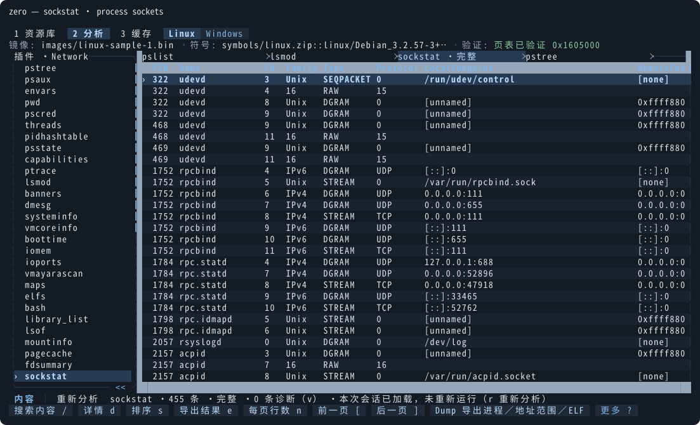

<div align="center">

# Zero

**原生 Rust 内存取证终端 · Linux 与 Windows · 精确符号匹配**

[](https://github.com/sunmedalia/zero/actions/workflows/ci.yml)
[](https://github.com/sunmedalia/zero/releases/latest)


[使用指南](docs/usage.md) · [兼容矩阵](docs/compatibility.md) · [Volatility 对齐进度](docs/volatility-parity.md) · [MCP](docs/mcp.md) · [界面架构](docs/tui.md) · [开发与发布](docs/development.md)


</div>

Zero 是本地内存取证工具：读取 Linux（x86_64／ARM64）与 Windows 内存镜像，用与内核**完全一致**的符号恢复进程、模块、文件、网络与内核完整性信息。分析引擎和终端界面全部用 Rust 实现，界面采用 Ratatui + Crossterm，键盘与鼠标都完整可用；同一个可执行文件还提供 CLI 和 stdio MCP 服务。分析本身不需要 Python、Volatility 或任何 HTTP 服务。

## 特点

| | |
| --- | --- |
| 🎯 **只用精确符号** | Linux 按完整内核 banner 匹配 ISF，Windows 按 PDB GUID／Age 匹配；找不到就明确说没有，从不套用“相近版本” |
| 🧾 **不把部分当完整** | 缺页、布局未验证、对象损坏都会保留部分结果并附带诊断；部分结果连同诊断单独缓存、绝不当作完整结果，“没有命中”只在完整结果中成立 |
| 🔒 **证据只读** | 镜像始终只读，资产移除只改项目清单；在线模式只查询／下载符号，`--offline` 禁止一切网络请求，从不上传镜像 |
| 🧩 **125 个原生插件** | Linux 62 个、Windows 63 个：进程、内存映射、文件、socket、注册表、恶意检测线索、内核钩子、模式搜索与定向转储 |
| 🖥️ **好用的终端** | 浏览器式页面标签、可拖动滚动条、命令面板、进程树、五套主题与跟随终端背景的自动主题；80×24 到超宽屏都有对应布局 |
| 🤖 **三种入口** | TUI、脚本化 CLI（CSV／JSON 导出）与原生 MCP（结果快照分页、可取消） |

## 截图

<table>
  <tr>
    <td width="50%"><br><sub><b>sockstat</b> — 每个进程 FD 引用的 Unix／TCP／UDP socket</sub></td>
    <td width="50%"><br><sub><b>主题</b> — 在 <code>,</code> 设置中切换，图为“纸白”</sub></td>
  </tr>
  <tr>
    <td width="50%"><br><sub><b>资源库</b> — 镜像、本地符号与远程索引</sub></td>
    <td width="50%"><br><sub><b>缓存管理</b> — 按范围清理，重新打开导出记录</sub></td>
  </tr>
</table>

<sub>截图由 <code>make screenshots</code> 用真实引擎分析公开的 Debian 3.2 样本生成，就是终端里的实际画面。</sub>

## 安装

**发布包**（Linux x86_64／ARM64、macOS ARM64）：从 [Releases](https://github.com/sunmedalia/zero/releases/latest) 下载对应归档并用 `SHA256SUMS` 校验。原生版本解压即可运行，无需 Node、npm 或外部界面文件。

```sh
sha256sum --check --ignore-missing SHA256SUMS   # macOS: shasum -a 256 -c --ignore-missing SHA256SUMS
tar xzf zero-*.tar.gz && cd zero-*/
./zero
```

**从源码构建**：

```sh
cargo build --release --locked
./target/release/zero
```

## 快速开始

```sh
# 打开终端界面：不带参数进入工作台，或直接指定镜像与符号
zero
zero --image images/memory.lime --symbols symbols/kernel.json.xz

# 命令行分析并导出
zero --offline analyze --image /evidence/memory.raw --symbols /evidence/kernel.json.xz \
  --plugin pslist --output exports/processes.json

# 识别内核并下载精确匹配的符号
zero symbols --image /evidence/memory.raw --download

# 只转储指定进程，附 SHA256 清单
zero dump --image /evidence/memory.raw --mode process --pid 1 \
  --dump-dir exports/dumps --output exports/dump-index.csv

# stdio MCP 服务
zero mcp
```

在界面里：启动后先在资源库用 Space 选用镜像，Zero 按 banner／PDB 签名自动识别系统（识别结果与镜像绑定，再次选用无需重扫）并匹配本地符号；`M` 在线获取精确符号，Enter 进入分析，点击插件即运行。`1`／`2`／`3` 切换资源库、分析、缓存，状态栏标明每个结果是“缓存读取”还是“重新分析”。`?` 打开命令面板，`H` 查看全部快捷键。完整操作见[使用指南](docs/usage.md)。

## 支持范围

| | 支持 |
| --- | --- |
| 镜像格式 | RAW、LiME（含未压缩的 AVML 输出）、Windows crash dump／minidump、已识别布局的休眠文件、gzip 压缩镜像 |
| 符号格式 | ISF 的 JSON、JSON.XZ 与 ZIP 成员 |
| Linux | x86_64 四级页表（含 KASLR）与 ARM64 4 KiB 页（39／48-bit VA）；已验收 Debian 3.2 与 Kali 6.8.11 ARM64 |
| Windows | 按精确 PDB 获取并本地转换符号，微软 404 时从 Volatility 官方符号包按需取精确 ISF；样本与插件覆盖见[兼容矩阵](docs/compatibility.md) · [Volatility 对齐进度](docs/volatility-parity.md) |
| 符号来源 | 本地文件、[Abyss-W4tcher/volatility3-symbols](https://github.com/Abyss-W4tcher/volatility3-symbols)、Microsoft 符号服务器；Kali ARM64 可从官方调试包生成 |

休眠文件与压缩 store 的部分路径只有合成验证，具体范围以兼容矩阵为准。恶意检测插件给出的是需要核查的结构线索，不是恶意判定。

## 文档

| 文档 | 内容 |
| --- | --- |
| [使用指南](docs/usage.md) | 界面、快捷键、CLI、全部 Linux 插件的字段与边界、缓存与设置、验收基线 |
| [兼容矩阵](docs/compatibility.md) | Windows 插件与真实样本的验收证据 |
| [Volatility 对齐进度](docs/volatility-parity.md) | 固定版本清单、真实差分用例与未完成项 |
| [MCP](docs/mcp.md) | 工具接口、`result_id` 快照分页与取消 |
| [界面架构](docs/tui.md) | 原生线程通信、布局、鼠标、页面标签、主题及 GitHub 下载代理 |
| [开发与发布](docs/development.md) | 检查、资源预算、性能基准、CI、发布与截图 |
| [性能测量](docs/performance.md) | 可复现的基准记录 |
| [Agent skill](.agents/skills/zero-forensics/SKILL.md) | 供 AI 代理调用的说明与[示例](.agents/skills/zero-forensics/references/calls.md) |

## 开发

```sh
make check        # 界面构建、fmt、Clippy、Rust 测试、tsc、界面测试、release 构建
make tui-acceptance acceptance windows-acceptance   # 需要本地真实样本
```

CI 在 Linux x86_64／ARM64、macOS ARM64 上运行 `make check`；推送 `v*` 标签后自动构建并发布这三个目标的归档，后续不再发布 macOS Intel 版本。详见[开发与发布](docs/development.md)。
