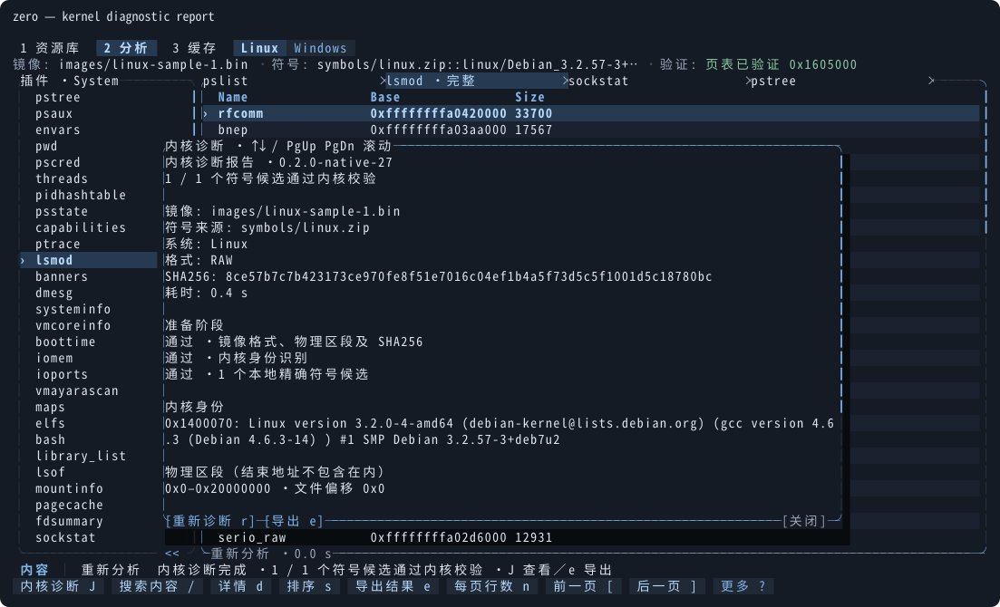

# Rust 原生终端界面

[← 项目首页](../README.md) · [使用指南](usage.md) · [开发与发布](development.md) · [功能对齐检查](tui-parity.md)

TUI 使用 Ratatui + Crossterm，与分析引擎一起编译进 `zero`。构建和运行不需要 Node、npm 或外部界面文件。直接运行 `zero` 打开资源库，传入 `--image` 时打开分析工作台；选择镜像后先校验 SHA256，再匹配本地精确符号；资源库选用并匹配成功后自动进入对应 Linux／Windows 分析页，不自动运行插件。分析页只显示 Linux／Windows 按钮，可手动切换，系统自动识别在后台完成。

## 架构与启动

```text
zero
├─ 无子命令       Rust TUI → 后台线程 → 共享引擎服务
├─ analyze|dump|… CLI → Rust 分析引擎
└─ mcp           stdio MCP
```

`src/tui.rs` 管理终端生命周期与事件循环；`src/tui/` 按应用状态、动作、布局、页面、对话框、任务、标签、滚动条和主题拆分。`src/engine_service.rs` 提供项目路径、镜像校验、识别、匹配、分析、缓存清单和符号保存逻辑。原生界面使用 Rust 类型传递请求与结果，不启动子进程或编码 JSON-RPC。

项目根目录使用 `ZERO_ROOT`，未设置时使用当前目录。设置中的相对路径、输入路径和 CLI 初始选择均按项目根目录解析。`--offline`、`--image`、`--symbols`、`--os`、`--arch`、`--pagefile`、`--swapfile`、`--hive`、`--key`、`--pattern` 保持支持。旧设置、项目清单、缓存、部分结果与导出记录继续使用，无需迁移。`ZERO_TUI_DIR`、`ZERO_TUI_BACKEND` 不再用于原生界面。

## 布局与输入

- `1`／`2`／`3` 切换资源库、分析、缓存；兼容 F2／F3／F4。`?` 或 Ctrl+P 打开命令面板，`,` 打开设置。
- `H` 帮助、`S` 系统、`R` 运行、`V` 校验镜像；兼容原功能键。
- 资源库的镜像、本地库、远程索引分别占满内容区域，Tab／Shift+Tab 切换来源。路径按显示宽度换行，多行条目与点击共用矩形；`d` 打开详情。
- 分析页 100 列且 24 行起使用插件／结果双栏；80×24 显示聚焦区域；插件框底部 `<<` 收起列表，内容区右下角 `>>` 展开；兼容 `B` 快捷键，收起后结果使用全部可用宽度。详情默认关闭，160 列且 28 行起可显示 38 列侧栏，其余尺寸覆盖结果区。
- 小于 60×16 显示尺寸提示。中文宽字符与组合字符由终端 Buffer 绘制，控制字符转义显示。
- `/` 根据当前焦点搜索：插件区在插件框内打开搜索窗口，内容区在结果区内打开搜索框；`p` 同样打开插件搜索。
- 结果表支持筛选、排序、树折叠、水平滚动和结果标签。Ctrl+PgUp／PgDn 切换标签，Ctrl+W 关闭；标签支持点击、关闭按钮及中键关闭；标签保持可读宽度，超出时用右侧 `<`／`>` 平移展示，不改变当前结果。关闭运行中的插件前须先取消。
- 鼠标支持页面、来源、按钮、列表行和表头；滚轮滚动列表，右边框滚动条支持跳转及拖动。绘制使用的区域同时注册为命中区域。点击弹窗外会关闭弹窗，并消费该次点击。
- 缓存页提供范围与条目两列，Tab 或 ←／→ 切换焦点，Space 勾选范围；鼠标第一次点击高亮，第二次执行。结果按镜像分组，Enter 折叠／展开组或打开导出记录；Delete 删除条目／组，x 清理勾选范围（兼容 C），同一清理键再次确认后执行，Esc 撤销。
- dump 表单用 Alt+1…7 选择当前系统支持的模式；保留 F2…F4。支持现有 Process、Range、ELF／PE、VAD、DLL、Module、Files 模式。参数表单支持 PID、hive、键、架构、分页文件和扫描模式，Ctrl+T 展开高级配置。

远程页始终显示搜索框，点击或 `/` 输入，Enter 确认、Esc 撤销；优先读取已保存的完整索引，不自动下载；`z` 或顶部按钮切换全部／当前镜像匹配，`g` 获取、`r` 刷新。进入缓存页使用独立清单查询，保留正在执行的分析。

分析页的系统按钮与页面导航同列，下一行直接显示镜像、符号及验证信息，不重复显示系统名称。

动作表统一定义命令、标签、快捷键、适用页面和展示位置；命令面板、资源工具栏与页脚复用该表。布局阈值集中在 `layout.rs`。

## 任务、取消和结果

文件分析、校验、符号操作、缓存清理、导出与历史加载在后台线程执行，使用引擎已有的 `Job` 进度及协作取消标志。任务在启动线程前分配标识；事件携带任务号和对象版本，旧会话和被取消的结果不会更新当前界面。同一时刻只执行一个长任务，重复请求取消旧任务后只执行最后一个请求。

Esc 按层级关闭弹窗／详情、清除筛选，最后取消任务。取消清空自动后续流程，下一次任务使用新的取消标志。退出时取消并回收 worker，恢复 raw mode、鼠标、括号粘贴和备用屏幕；UI panic 也恢复终端。

插件结果底边显示本次分析／缓存来源及耗时。部分结果保留诊断，可导出，沿用独立部分缓存；成功缓存语义不变。导出成功后记录校验副本；记录失败仍显示已导出，并报告记录错误。导出记录在内存中使用共享引用，标签切换无需复制行数据。

## 内核诊断

资源库工具栏、分析页操作栏及命令面板提供“内核诊断 J”。选用镜像后按 `J`，后台读取本地镜像和精确符号，检查镜像格式、SHA256、物理区段、内核身份及引擎页表校验。支持 Linux 与 Windows；诊断本身不联网，也不运行分析插件。

报告中的内核身份只保留格式完整的 banner 候选，过滤源码、测试代码、多行文本和不完整命中，并记录过滤数量；扫描候选仍需结合页表校验，原始符号匹配与校验不受过滤影响。报告保留每个符号候选的成功或失败证据。Linux 页表校验失败时可直接查看重定位候选、`init_task`、链表头及双向回指；字段缺失、符号未匹配或镜像读取失败也会形成报告。已有分析结果、筛选、行选择和标签页保持原状。

x86_64 内核发现增加独立 `init_files` 指针及虚实地址校验；通过后，即使任务链异常也允许部分分析。进程列表分别沿捕获的 next/prev 链逐对象恢复，保留回指冲突、断链和重复 PID 诊断，不补写指针或缺页。缺少独立证据时仍须通过严格链表验证或受限的完整正向旧尾节点验证。部分结果使用独立缓存；不能断言异常由活体采集造成。详见 [Volatility 对齐进度](volatility-parity.md)。

弹窗内 ↑↓、PgUp／PgDn、Home／End 滚动，`r` 重新诊断，`e` 导出 `.json` 或 `.txt`。默认保存到导出目录下的 `diagnostics/`，可修改路径；报告不会覆盖当前镜像或符号源文件。诊断运行中按 Esc 或点击弹窗外取消；已有报告可在分析运行时只读查看，重跑和导出需等待空闲。



## 主题

保留石板、纸白、Solarized、荧光绿和高对比主题，设置中的 `theme` id 保持兼容。未知 id 回退到石板。`auto` 在 Unix 终端启动时查询 OSC 11，DA1 或最长一秒结束等待；无回复时使用 `COLORFGBG`，再回退深色。其他宿主使用 `COLORFGBG` 回退。调色板按 UI 线程保存，测试和截图可独立选择主题。

## 构建与检查

```sh
cargo build --release --locked
cargo run --release --bin zero
make check
make ui-test          # Rust TUI 单元测试的兼容入口
make tui-acceptance   # 需要本地真实样本
make screenshots     # Rust 示例使用真实引擎与同一个 Buffer 输出 SVG
```

常规测试使用内存结果和合成样本，覆盖状态机、任务竞态、布局、鼠标命中、宽字符、主题和终端尺寸。真实样本路径可通过 `ZERO_TEST_IMAGE`／`ZERO_TEST_SYMBOLS` 覆盖。发布包只包含原生可执行文件和文档，PTY 验证在空 PATH 及不同工作目录中运行。

## GitHub 下载线路

设置页的“GitHub 下载”提供三种模式，并保存为 `.zero/rust/settings.json` 的 `github_access`：

- `auto`（默认）：先直连 GitHub，直连传输最多等待 20 秒；连接或传输失败时尝试 gh-proxy.com。
- `direct`：只直连 GitHub。
- `gh-proxy`：直接使用 `https://gh-proxy.com/<原始 HTTPS 地址>`，适用于无法访问 GitHub 的网络。

代理地址拼接方式见 [GH-Proxy 使用指南](https://gh-proxy.com/docs/github-accelerator)。此设置用于 GitHub 的远程 banner 索引、Raw ISF 和 Release 符号文件。仓库地址、索引条目和缓存来源仍保存原始 GitHub URL，下载后继续校验完整 banner／身份。Microsoft 符号服务器与官方 Windows ZIP 保持原下载地址；离线模式禁止新的下载。HTTP 404 和用户取消不会触发代理重试。

TUI 仅通过 Rust 类型和线程通道调用引擎，迁移期间的 `tui-backend` 子命令已移除。对外 MCP 接口详见 [MCP 说明](mcp.md)。
