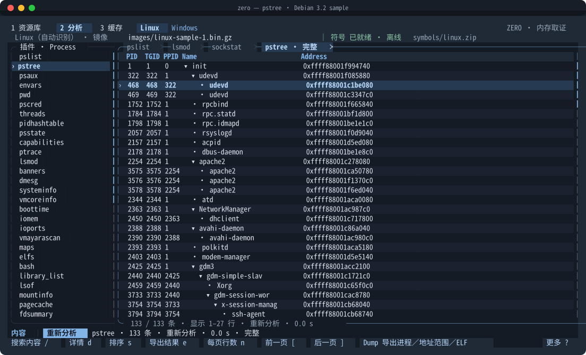
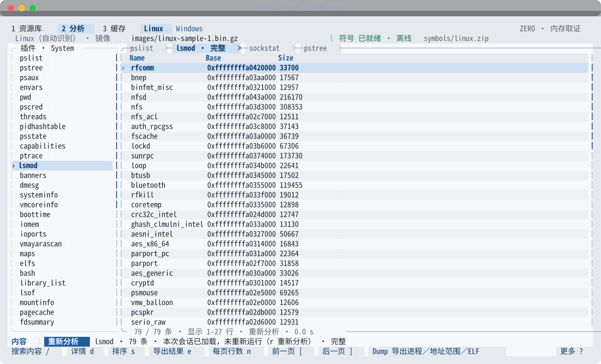
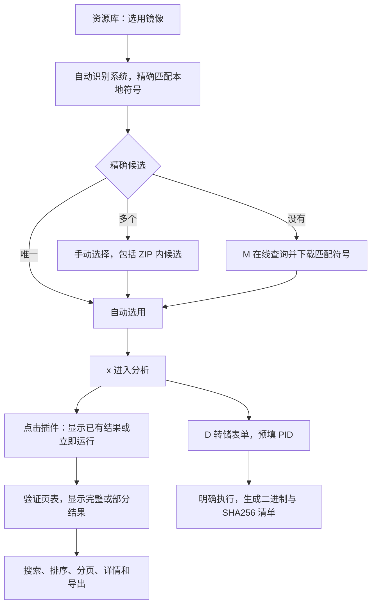
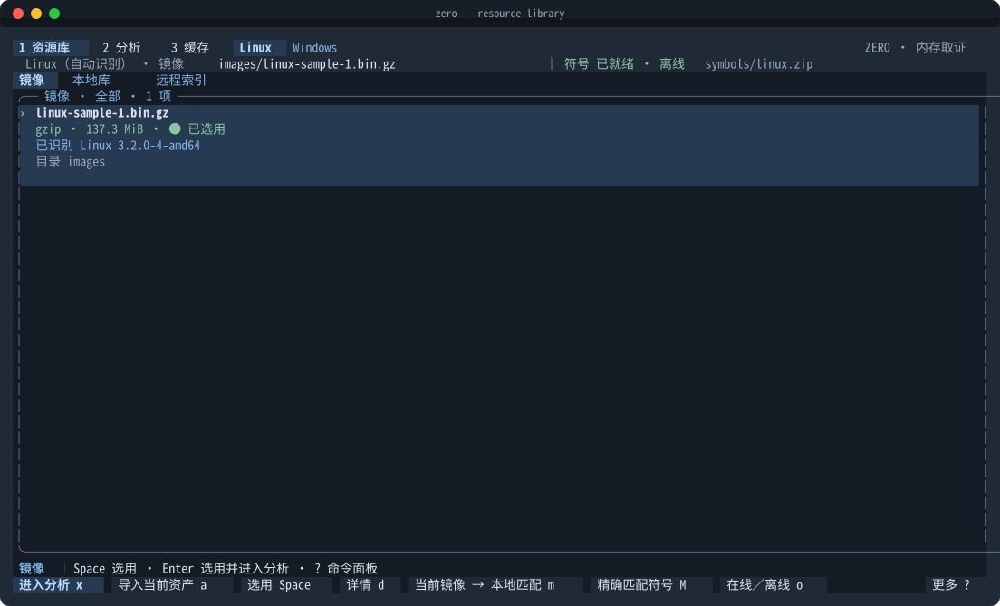
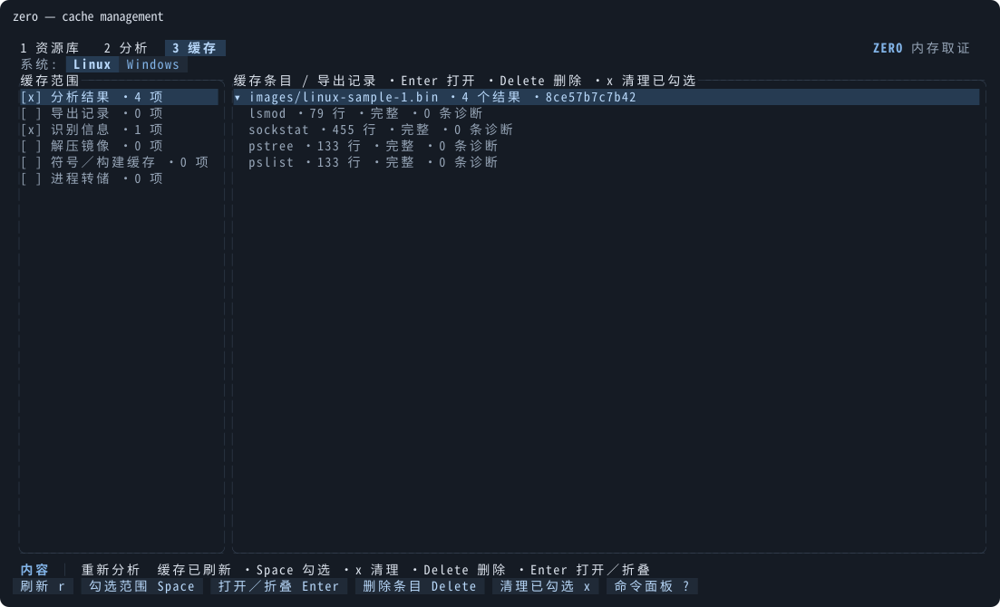

# 使用指南

[← 项目首页](../README.md) · [终端界面架构](tui.md) · [MCP](mcp.md) · [兼容矩阵](compatibility.md) · [开发与发布](development.md)

本页覆盖 TUI、CLI 和全部 Linux 插件的字段与边界。命令均从项目根目录运行。

- [1. 安装与启动](#1-安装与启动)
- [2. 界面总览](#2-界面总览)
- [3. 准备镜像与符号](#3-准备镜像与符号)
- [4. 分析、结果与导出](#4-分析结果与导出)
- [5. 快捷键与鼠标](#5-快捷键与鼠标)
- [6. 命令行](#6-命令行)
- [7. Linux 插件参考](#7-linux-插件参考)
- [8. Windows 要点](#8-windows-要点)
- [9. 设置、缓存与运行数据](#9-设置缓存与运行数据)
- [10. 验收基线](#10-验收基线)

---

## 1. 安装与启动

```sh
cargo build --release --locked
(cd ts && npm install --no-audit --no-fund && npm run build)
./target/release/zero --image images/linux-sample-1.bin.gz --symbols symbols/linux.zip
# 或安装到 Cargo bin 目录；之后 zero 打开 TUI，zero analyze 执行分析，zero mcp 启动 MCP
cargo install --path . --locked
```

不带参数启动进入**资源库**：保留资产清单，但不恢复上次的镜像，Space 选用镜像、Enter 选用并进入分析。显式 `--image` 直接进入分析工作台，并自动识别系统、匹配本地符号。镜像始终只读；`--offline` 完全禁止网络请求。首次进入按 `i` 或点击“选择镜像”开始准备；准备完成不会自动运行分析。

## 2. 界面总览



### 页面与标签

第一行是三个页面：**资源库**、**分析**、**缓存**，用 `1`／`2`／`3` 切换，也可点击或用 Ctrl+←/→ 循环；其后是系统选择 Linux／Windows：默认按镜像 banner／PDB 签名自动识别，识别出的系统直接高亮并切换到对应插件，第二行显示“Windows（自动识别）”；点击另一个系统改为手动指定，点击已高亮的系统不做任何事。`S` 可以回到自动识别。

分析页结果表的标题行是**打开的页面标签**，与浏览器标签相同：

- 点击或搜索打开插件、或得到结果时打开标签；进入分析时默认选中的插件不开标签。同一插件只占一个标签，同一条导出记录或同一个历史文件再次打开时复用原标签，标题前缀“记录·”。当前标签高亮，并显示完整／部分／历史状态。
- 还没显示过任何内容的标签（例如长任务运行中改点了别的插件，原任务被取消）会被下一个打开的插件直接复用，不会堆出一排空标签。
- 点击切换，点击 `×` 或鼠标中键关闭；Ctrl+PgUp／Ctrl+PgDn 切换，Ctrl+W 关闭当前标签。
- 标签多时标题先缩短；再放不下时只显示当前标签附近一段，两端的 `‹n`／`n›` 表示隐藏数量，点击跳过去。
- 关闭标签会丢弃其内存结果，再次打开读取成功缓存或重新运行；关闭当前标签切到右侧相邻标签，没有则切到左侧。运行中的标签需先按 Esc 取消。更换镜像或符号后插件标签随结果清除，导出记录标签保留。

第二行显示系统、镜像、符号准备状态与在线／离线模式。

### 布局

| 终端尺寸 | 布局 |
| --- | --- |
| 低于 60×16 | 只显示尺寸提示，可按 q／Ctrl+C 退出 |
| 80×24 起 | 插件与结果按焦点切换，第一行用“插件／内容”区域标签代替系统选择 |
| 100×24 起 | 24 列插件菜单与结果并排 |
| 160×28 起 | `d` 详情改为 38 列右侧栏（较小尺寸覆盖结果区） |

内容超出时，结果表、资源列表、插件菜单、详情和缓存列表的右边框显示滚动条：点击轨道跳转，按住滑块拖动。底部固定两行：状态行，以及当前区域的操作按钮；放不下的操作收进“更多 ?”。

### 主题

`,` 打开设置，在“界面主题”一行按 Enter 或 ←→ 切换，立即生效并保存。可选：

| id | 名称 | 适合 |
| --- | --- | --- |
| `slate` | 石板（默认） | 深色终端 |
| `light` | 纸白 | 浅色终端、投影、截图 |
| `solarized` | Solarized | 熟悉 Solarized 配色的用户 |
| `phosphor` | 荧光绿 | 复古终端风格 |
| `contrast` | 高对比 | 低视力或强光环境 |

<p align="center"></p>

## 3. 准备镜像与符号





### 资源库

资源库管理镜像、本地符号（JSON／JSON.XZ／ZIP）和远程符号索引。上方“镜像／本地库／远程索引”标签各占一页（Tab／Shift+Tab 循环），筛选条件与选中位置分别保留。

- 高亮行表示正在浏览，“●已选用”表示当前分析对象。`i`／`y` 导入镜像／符号，`a` 导入当前类型；Space 选用，Enter 选用并进入分析，`d` 查看详情，Delete 移出清单。导入只登记路径，移出只修改项目清单，原文件始终保留。
- 选用镜像后自动识别系统并精确匹配本地符号：唯一候选自动选用；多个候选（包括 ZIP 内各成员）由用户选择。系统不明确时按 `S` 手动选择。
- `m` 重试本地匹配，`M` 查询、下载并选用远程精确符号，多候选先选择。两者始终作用于**当前选用**的镜像，列表里高亮另一个镜像不会改变匹配对象。
- 匹配结果绑定镜像与符号文件元数据，未变化时复用，切换镜像后清除。
- 首次选用镜像时识别出的内核 banner（Linux）或 PDB 身份（Windows）与该镜像文件绑定，镜像条目下显示“已识别 Linux 3.2.0-4-amd64”之类的一行，`d` 详情列出全部候选。文件大小、修改时间或 inode 变化后绑定失效，需要重新识别。
- 搜索框只在编辑或已有查询时出现；`/` 搜索当前列表。

匹配规则：Linux 按完整 banner 匹配 [Abyss-W4tcher/volatility3-symbols](https://github.com/Abyss-W4tcher/volatility3-symbols) 的索引；Windows 按 Microsoft PDB 名称、GUID 和 Age 精确匹配。没有候选会明确说明，**从不按相近版本猜测**。

### 远程索引

- 索引获取一次后保存在 `.zero/rust/symbols/banners_plain.json`。之后每次打开“远程索引”都直接读取这份本地索引，不访问网络；`g` 同样复用它，只有本地没有时才下载；`r` 重新下载。
- `g` 获取完整索引，`/` 在引擎中检索整个索引：每次返回前 500 项并显示匹配总数；内核版本以搜索词开头的优先，其次整词匹配，再按版本从新到旧。
- 索引条目可以是仓库路径，也可以是该仓库 Releases 资产的完整 URL（当前上游格式），都规范化为仓库相对路径；其他来源的 URL 一律拒绝。只列出原生引擎能转换的 Linux x86_64／ARM64 条目。
- 解析后的索引按文件版本保留在内存中；状态行显示条目数与更新时间。
- 点击条目打开详情：发行版、内核版本、架构、编译器与构建信息，完整 banner、文件名和下载链接。底边的按钮可直接点击：“下载并选用 Space”（已选用镜像时出现，下载后按镜像校验 banner 并选用）、“仅下载 w”（只保存到本地库）、“本地库查看 L”（已下载时出现）。
- `t` 切换本地／远程，`r` 刷新。离线时读取缓存索引，没有完整匹配时显示 0 个候选。

### 生成符号

仓库没有对应构建时，`K` 打开“生成当前镜像符号表”：

- Kali 6.8.11-1kali2 ARM64 自动从 [Kali 官方归档](https://old.kali.org/kali/pool/main/l/linux/) 获取调试包与内核配置，只提取 ELF／config，不安装 deb、不执行维护脚本。
- 其他 Linux 构建填写匹配的调试 ELF、内核配置与 dwarf2json 路径。
- 生成后校验完整 banner，保存到本地符号库并选用，不自动运行分析。详见 [6.3](#63-符号识别下载与生成)。

### 文件选择器

分析页 `i`／`y`、资源库 `a` 或点击第二行的路径，会打开配置目录的文件弹窗，列出该目录的实际文件与子目录：

| 按键 | 作用 |
| --- | --- |
| ↑↓ | 选择 |
| Enter／→ | 打开目录；文件条目用已选对象进入分析 |
| ←／Backspace | 上级目录 |
| Space／Shift+Space | 选用文件或当前目录／选用当前符号目录 |
| Tab | 在镜像与符号目录间切换 |
| `w` | 返回当前类型的配置目录 |
| `p` | 手动输入路径 |
| `d` | 文件详情 |

## 4. 分析、结果与导出

### 运行插件

- 左侧菜单每行一个插件，标题显示当前类别。点击插件或 Enter：已有结果立即显示，没有当前参数的结果则自动运行。
- Ctrl+R 明确运行当前插件与参数草稿，`r` 跳过结果缓存强制重跑。
- `P` 编辑适用参数：PID 只对支持的插件出现，hive／key 用于 printkey，搜索模式用于模式搜索插件；Windows 下 Ctrl+T 展开架构与分页附件高级配置。
- 每个插件与参数组合各自保存结果，以及筛选、排序、选中行和横向位置。

### 任务

- 同一时刻只有一个后台任务。浏览资产、已有结果或切换页面不打断任务。
- 点击尚无结果的插件或选用新对象，会取消当前任务，等线程退出后只执行最后一次请求。结果绑定实际执行的参数快照，旧任务的事件不会更新新对象。
- 进度已知时显示百分比，未知时显示阶段、已用时间与取消入口；`l` 查看最近 200 条任务消息。
- 失败可修复参数、路径或在线模式后重试。部分结果和诊断可以查看、导出，但不进入成功缓存。

### 浏览结果

- 结果标题显示插件与完整／部分／历史状态，底边显示筛选数量、可见行范围和结果来源：“重新分析 · 用时”表示引擎刚刚分析，“读取缓存 · 用时”表示读取了磁盘上的成功缓存；用时后的“（含镜像校验）”表示这次请求还完成了新会话必需的镜像内容摘要。切回本次会话已经显示过的结果时不访问引擎，状态行写“本次会话已加载，未重新运行”；`r` 忽略缓存重新分析。底部状态栏在“内容 │”之后始终带一个来源标记：绿色“缓存读取”或蓝色“重新分析”，其他提示替换状态文字时它也保留。
- 新会话的第一个插件最慢：它要完成镜像内容摘要（3.6 GB 约 17 秒）、内核定位和符号加载，之后同一会话的插件只做插件本身（多为毫秒级）。部分结果不写入缓存，所以下次打开会重新分析，但镜像准备可以复用（见 9.4）。
- `/` 实时筛选（Esc 撤销），`s` 选择排序列（再选同列反转），数字与十六进制按数值排序。
- `[`／`]` 或 PgUp／PgDn 翻页；`n` 设置每页行数（1–10000，`auto`／`0` 自动填满）。终端变小时实际行数不超过可见高度，翻页不会跳过看不到的行。
- 短列按内容收紧，长字段限宽；Alt+←/→ 横向滚动，`d` 查看完整字段。
- `pstree` 显示可展开的进程树，←／→ 折叠／展开。
- 无搜索匹配、正常空结果和不完整分析分别有说明；`v` 查看全部诊断。

### 为什么是“部分”

表中每一行都来自已读取并通过校验的对象；诊断列出无法读取或前后矛盾、因此没有列出的部分。Volatility 遇到这些对象通常静默跳过，所以同一镜像在 Volatility 中看起来“完整”，行数却相同或更少。状态行与 `v` 弹窗按类别汇总诊断：

| 类别 | 含义 | 能否改善 |
| --- | --- | --- |
| 页面不在镜像中 | 对象所在页已换出到 pagefile／swapfile、未提交，或不在镜像范围内 | 附加采集时的 pagefile／swapfile |
| 对象前后矛盾 | 链表指针、父指针或对象头与相邻对象矛盾；运行中采集的镜像常见，进程、线程或对象在采集过程中被创建或释放 | 不能，镜像本身如此 |
| 布局未验收 | 结构布局来自声明来源，尚未与此精确 PDB／驱动身份的真实样本对照 | 结果可用，需要核查 |
| 达到上限 | 读到的计数超过安全上限，按无效数据处理 | — |

例如 3.6 GB 的 Win11 样本在本机分析时，`windows.pslist` 列出 102 个进程，有 4 条诊断。它们指向同一个正在退出的进程：该进程的 `ActiveProcessLinks` 已被覆盖为文本 `-headers`。从链表另一端反向遍历后，其余进程全部列出。正常状态不算诊断：例如 Registry、MemCompression 这类最小进程的 `EPROCESS.Peb` 本来就是 0，`cmdline`／`envars`／`dlllist`／`iat` 对它们不输出行，也不因此标记为部分结果。

### 导出与历史

- `e` 导出全部筛选结果（不受当前页影响，包括折叠树内的匹配行）为 CSV 或 JSON。导出路径可在弹窗中修改，同名文件原子替换。
- `h` 浏览导出目录中的历史 CSV／JSON，使用相同的筛选、排序、详情和分页。
- 每次成功导出都会在缓存中留下**导出记录**（含导出文件的本地副本），可在缓存页重新打开，见 [9.3](#93-导出记录)。

### Dump

`D` 打开转储表单：Linux 提供 Process／Range／ELF，Windows 提供 Process／Range／PE，用 Alt+1／2／3 切换模式，Tab／Shift+Tab 切换字段。结果行含 PID 时自动预填，仍需点击“开始转储”或 Ctrl+Enter 明确执行；Esc 取消。默认目录为导出目录下的 `dumps/`。详见 [7.4](#74-dump)。

## 5. 快捷键与鼠标

所有按键、标签、命令面板、工具栏与底部按钮来自同一张动作表（`ts/src/actions.ts`），因此不会出现“面板里有、工具栏里没有”的情况。`?`／Ctrl+P 打开命令面板，可按空格分隔多个词搜索，支持 `cache`、`dump`、`pid` 等英文词。

### 全局

| 按键 | 操作 |
| --- | --- |
| `1` `2` `3`／Ctrl+←→ | 资源库／分析／缓存 |
| Ctrl+PgUp／Ctrl+PgDn／Ctrl+W | 切换／关闭顶部页面标签 |
| `?`／Ctrl+P | 命令面板 |
| `H` | 帮助与完整快捷键 |
| `,` | 设置：目录、分页、在线模式、界面主题 |
| `S` | 选择分析系统（自动识别／Linux／Windows） |
| `o` | 在线／离线 |
| `i`／`y` | 选择镜像／本地符号 |
| `m`／`M` | 当前镜像本地匹配／远程精确匹配 |
| `b` | 无需 ISF 识别内核 banner |
| `c`／`3` | 缓存页 |
| `l`／`h`／`v` | 任务日志／历史导出／诊断 |
| Esc | 关闭弹窗；分析页先清除筛选，再取消任务 |
| `q`／Ctrl+C | 退出（任务运行中 `q` 需按两次）／立即退出 |

### 资源库

| 按键 | 操作 |
| --- | --- |
| Tab／Shift+Tab | 镜像／本地库／远程索引 |
| Space／Enter | 选用／选用并进入分析 |
| `a`／Delete | 导入当前资产／移出清单（原文件保留） |
| `d`／`/`／`r` | 详情／搜索／刷新 |
| `t`／`g`／`w`／`z` | 本地↔远程／获取索引／仅下载／全部↔匹配 |
| `K` | 生成当前镜像符号表 |
| `x` | 进入分析 |

### 分析

| 按键 | 操作 |
| --- | --- |
| Tab／Shift+Tab | 切换区域（镜像信息、插件、结果、详情） |
| ↑↓／`j` `k`、PgUp／PgDn、Home／End | 导航 |
| Enter | 插件区运行当前插件，结果区展开树或打开详情 |
| `p`／`R`／Ctrl+R／`r` | 搜索插件／运行／运行草稿／强制重跑 |
| `P`（Windows 表单内 Ctrl+T） | 参数（高级配置） |
| `/`／`s`／`n`／`[` `]` | 筛选／排序／每页行数／翻页 |
| `d` | 字段详情；↑↓、PgUp／PgDn、Home／End 滚动，`d`／Esc 关闭 |
| ←／→ | 折叠／展开进程树 |
| Alt+←／Alt+→ | 横向滚动 |
| `e`／`D` | 导出／Dump |

### 缓存页

| 按键 | 操作 |
| --- | --- |
| ←→／Tab | 在范围列表与文件列表间切换 |
| Space／`x` | 勾选范围／清理已勾选（再按一次确认） |
| Delete | 删除当前条目（再按一次确认） |
| Enter／`r` | 重新打开导出记录／刷新 |

### 输入框

Ctrl+U 清空、Ctrl+A 全选、←→／Home／End 移动光标、Delete 删除；支持 Unicode 与终端粘贴。输入框默认选中原路径，直接输入即可替换。

### 鼠标

终端需支持 SGR 鼠标上报（xterm、iTerm2、Windows Terminal、tmux 均可）；不支持时一切仍可用键盘完成。

- **点击**：页面与页面标签、系统选择、资源列表条目、第二行的镜像／符号路径、插件、结果行、表头（排序，再点反转）、进程名称（展开／折叠）、工具栏按钮、对话框的每一行与按钮。点击模态外部不会穿透到页面。
- **中键**：关闭页面标签。
- **滚轮**：结果区每格移动 1 行，不按页边界跳动；列表、菜单、详情和缓存列表同样可滚动。
- **滚动条**：点击轨道跳转，按住滑块拖动；拖动时指针离开轨道也不中断。
- **右键**：取消弹窗或当前任务。

## 6. 命令行

### 6.1 分析与导出

```sh
zero analyze --image images/linux-sample-1.bin.gz --symbols symbols/linux.zip \
  --plugin pslist --output processes.json
zero analyze --image images/linux-sample-1.bin.gz --symbols symbols/linux.zip \
  --plugin lsmod --output modules.csv
# 内存中的 Bash 历史
zero analyze --image images/linux-sample-1.bin.gz --symbols symbols/linux.zip \
  --plugin bash --output history.json
zero --offline analyze --image images/linux-sample-1.bin.gz --symbols symbols/linux.zip \
  --plugin iomem --output exports/iomem.json
```

- 多个符号匹配时 CLI 列出候选标签，用 `--symbol-choice '完整候选标签'` 选择。
- `--no-cache` 强制重新分析。
- 只有完整结果返回成功；部分结果仍会导出，但返回非零状态并输出诊断，且不写入成功缓存。
- JSON 保留完整性、诊断、banner、符号来源与页表地址；CSV 只保存表格字段，诊断在终端显示。
- `enable_cache` 开启时，`--output` 的每次导出都会写一条导出记录；保存失败只提示“导出记录未保存”，不影响导出本身。

### 6.2 Dump

```sh
# 只转储 PID 1；二进制目录与清单分别指定
zero dump --image images/linux-sample-1.bin.gz --symbols symbols/linux.zip \
  --mode process --pid 1 --dump-dir exports/dumps --output dump-index.csv
# 指定用户虚拟地址范围（先用 maps 获取范围）
zero dump --image images/linux-sample-1.bin.gz --symbols symbols/linux.zip \
  --mode range --pid 1 --start 0x608000 --end 0x609000 \
  --dump-dir exports/dumps --output range.json
# 导出含 ELF 头的映射
zero dump --image images/linux-sample-1.bin.gz --symbols symbols/linux.zip \
  --mode elf --pid 1 --dump-dir exports/dumps --output elf-index.csv
```

推荐使用 `dump --mode process|range|elf`；原 `analyze --plugin procdump|memdump|elfdump` 调用保持兼容。

### 6.3 符号识别、下载与生成

```sh
# 返回内核 banner、仓库路径和下载链接
zero symbols --image images/linux-sample-1.bin.gz --output symbols-match.json
# 下载精确匹配到私有缓存；--refresh 强制刷新索引
zero symbols --image images/linux-sample-1.bin.gz --download --refresh
# 不指定 --symbols 时使用设置路径，并自动匹配下载缓存／仓库
zero analyze --image images/linux-sample-1.bin.gz --plugin threads --output threads.json
# 已下载匹配的 ISF 后可完全离线分析
zero --offline analyze --image images/linux-sample-1.bin.gz --plugin pscred --output credentials.json

# 生成 Kali ARM64 符号；输出 .zero/rust/symbols/isf/<摘要>.json.xz
zero symbols-generate --image images/kali.raw --kali
# 其他内核显式提供调试 ELF、内核 config 与 dwarf2json
zero symbols-generate --image sample.raw --elf vmlinux --config kernel.config --tool /path/to/dwarf2json --offline
```

- 索引缓存 `.zero/rust/symbols/banners_plain.json`：在线模式每 24 小时更新，断网时使用有效的旧索引。
- ISF 存放在 `.zero/rust/symbols/isf/`，旁边的 `.source.json` 记录完整 banner、仓库路径与下载 URL。
- 下载校验 HTTPS、索引路径、ISF 格式与完整 banner，分析前继续验证页表。下载与解压上限各 256 MiB，连接超时 10 秒，总超时 90 秒，Esc 可中断；取消或失败不提交半个文件。
- 远程下载缓存命名为“可读名称 + 仓库路径 SHA256 后缀”；保存到本地库的文件使用 ISF 内容 SHA256 后缀。
- `--kali` 先复用 `symbols/` 或缓存中的精确 ISF。没有时，首次准备需要系统 `curl`、`ar`、`tar`、`git` 与 Go；dwarf2json 固定在 `9f14607e0d339d463ea725fbd5c08aa7b7d40f75`，在独立构建目录编译，不作为运行时插件。生成的 ISF 记录 ELF／config／工具摘要、准确 syscall 表长度与页表配置，banner 不一致即拒绝。`--offline` 不获取任何缺失文件。

### 6.4 缓存

```sh
zero cache list
zero cache clear --scope results,identification --dry-run
zero cache clear --scope results,identification --yes
# 范围：results、exports、identification、images、symbols、dumps 或 all
```

## 7. Linux 插件参考

共 52 个插件：`pslist`、`pstree`、`lsmod`、`psaux`、`envars`、`maps`、`lsof`、`sockstat`、`netscan`、`banners`、`pwd`、`pscred`、`threads`、`mountinfo`、`check_creds`、`dmesg`、`systeminfo`、`elfs`、`bash`、`malfind`、`psxview`、`check_modules`、`check_syscall`、`psstate`、`capabilities`、`fdsummary`、`procdump`、`memdump`、`elfdump`、`iomem`、`ioports`、`ptrace`、`keyboard_notifiers`、`check_exec`、`check_idt`、`tty_check`、`hidden_modules`、`library_list`、`pidhashtable`、`vmcoreinfo`、`ip_addr`、`ip_link`、`check_afinfo`、`kthreads`、`netfilter`、`tracepoints`、`ftrace`、`ebpf`、`boottime`、`pagecache`、`perf_events`、`vmayarascan`。

TUI 插件菜单只列分析插件，转储统一在 `D` 中。这些都是本地 ISF 驱动的 Rust 实现，不执行 Volatility Python 插件。

### 7.1 字段

进程（`pslist`／`pstree`）字段为 PID、TGID、PPID、Name、Address，PID 0 不进入结果；`pstree` 用 PPID 表达父子关系。模块（`lsmod`）字段为 Name、Base（`module_core`／`core_layout.base`）、Size（整个核心内存区域，字节）。地址均为完整虚拟地址。

| 插件 | 字段 |
| --- | --- |
| psaux | PID、Name、CommandLine、Status |
| envars | PID、Name、Key、Value |
| maps | PID、Name、Start、End、Permissions、FileOffset、Path |
| lsof | PID、Name、FD、Type、Inode、Path、FileAddress |
| netscan | PID、Name、Protocol、LocalEndpoint、RemoteEndpoint、State、SocketAddress |
| sockstat | PID、Name、FD、Family、Type、Protocol、LocalEndpoint、RemoteEndpoint、State、SocketAddress |
| banners | Offset（物理地址）、Banner；无需 ISF |
| pwd | PID、Name、Root（全局路径）、CWD（相对进程根） |
| pscred | PID、Name、UID、GID、EUID、EGID、SUID、SGID、FSUID、FSGID、CredAddress |
| threads | PID、Name、TID、ThreadName、Address |
| mountinfo | PID、Name、MountID、ParentID、Device、MountPoint、FileSystem、Flags、Address |
| check_creds | CredAddress、PIDs、Names、UID、EUID |
| dmesg | Index、Message（现代日志的 Index 为 seq） |
| systeminfo | Key、Value；镜像／符号摘要、架构、页大小、重定位、验证状态 |
| elfs | PID、Name、Start、End、Type、Entry、Path |
| bash | PID、Name、Timestamp、Command、Address |
| malfind | PID、Name、Start、End、Permissions、Path、Reason、Preview |
| psxview | PID、Name、Address、Tasks、PIDIndex、ThreadGroup、Reason |
| check_modules | Name、Address、Start、End、ModuleList、Sysfs、Reason |
| check_syscall | Table、Index、Target、Symbol、Owner、Reason |
| check_idt | Index、Address、Symbol、Owner、Present、Reason |
| check_exec | 匿名主程序代码、不可执行代码、映射空隙与主程序文件不一致的线索 |
| tty_check | Name、Address、Symbol、Owner、Reason |
| hidden_modules | Name、Address、Start、End、State、Reason |
| library_list | PID、Name、LoadAddress、Path |
| pidhashtable | Address、PID、TGID、PPID、Name |
| vmcoreinfo | Key、Value |
| ip_addr | Namespace、Interface、MAC、Promiscuous、Address、Prefix、Scope、State |
| ip_link | Namespace、Interface、MAC、State、MTU、Flags |
| check_afinfo | Structure、Member、Address、Symbol、Owner、Reason |
| kthreads | PID、Name、ThreadFunction、Symbol、Owner、Reason |
| netfilter | Namespace、Protocol、Hook、Priority、Handler、Symbol、Owner、Reason |
| tracepoints | Tracepoint、Handler、Symbol、Owner、Reason |
| ftrace | Ops、Handler、Symbol、Owner、Reason |
| ebpf | ID、Name、Type、Address、Function |
| perf_events | PID、Name、Event、Type、Config、Handler、Symbol、Owner、Reason |
| vmayarascan | PID、Name、Address、Start、Permissions、Path、Context |
| boottime | Key、Value（Unix 秒、UTC、纳秒） |
| pagecache | SuperBlock、Device、FileSystem、Inode、InodeAddress、Mode、Size、CachedPages、Path |
| psstate | PID、Name、State、ExitState、Flags |
| capabilities | PID、Name、Inheritable、Permitted、Effective、Bounding、CredAddress |
| fdsummary | PID、Name、Total、Regular、Sockets、Pipes |
| iomem／ioports | Name、Start、End、Depth、Flags、Address |
| ptrace | Process、PID、TID、TracerTID、TraceeTID、Flags |
| keyboard_notifiers | Address（回调）、Module、Symbol、Priority、NotifierAddress |
| procdump／memdump／elfdump | PID、Name、Start、End、Size、SHA256、File |

### 7.2 与 Volatility 3 的对应

| Zero | Volatility 3 | 解析范围 |
| --- | --- | --- |
| `iomem` | [linux.iomem](https://volatility3.readthedocs.io/en/latest/volatility3.plugins.linux.iomem.html) | 从 `iomem_resource` 遍历资源树，类似 `/proc/iomem` |
| `ioports` | 本项目扩展 | 从 `ioport_resource` 遍历 I/O 端口资源树；ARM64 可能只有少量根资源 |
| `ptrace` | [linux.ptrace](https://volatility3.readthedocs.io/en/latest/volatility3.plugins.linux.ptrace.html) | 包含非组长线程，输出 tracer 与 tracee；无跟踪关系为空表 |
| `keyboard_notifiers` | [linux.malware.keyboard_notifiers](https://volatility3.readthedocs.io/en/latest/volatility3.plugins.linux.malware.keyboard_notifiers.html) | 遍历键盘通知链，显示回调及内核／模块归属 |
| `check_idt` | linux.malware.check_idt | 解码 x86_64 `idt_table` 每个门的处理函数归属；ARM64 明确报告不支持 |
| `tty_check` | linux.malware.tty_check | 遍历 `tty_drivers` 的已打开 TTY，检查行规程 `receive_buf` 归属 |
| `hidden_modules` | linux.malware.hidden_modules | 在模块内存范围内按 `mkobj.mod` 自引用雕刻 `struct module`，报告不在 `modules` 链表中的模块 |
| `pidhashtable` | linux.pidhashtable | 从 PID 索引（IDR xarray 或旧版 pid_hash）列出任务，独立于 tasks 链表 |
| `vmcoreinfo` | linux.vmcoreinfo | 读取 `vmcoreinfo_data`（4.15 起为指针）中的 KEY=VALUE |
| `ip_addr` | linux.ip.Addr | 遍历 `net_namespace_list`（旧内核只有 `init_net`）中每个网卡的 IPv4／IPv6 地址 |
| `ip_link` | linux.ip.Link | 每个网卡的 MAC、operstate、MTU 与接口标志 |
| `check_afinfo` | linux.malware.check_afinfo | 检查 `tcp/udp/udplite` 的 `seq_fops` 与 `seq_ops.show`；4.18 起无该结构，明确报告不支持 |
| `kthreads` | linux.kthreads | 列出 PF_KTHREAD 任务；布局含 `kthread.threadfn` 时归属线程函数，否则标为 ThreadFnNotInLayout |
| `netfilter` | linux.malware.netfilter | 旧内核遍历全局 `nf_hooks`；4.13 起遍历各命名空间的 `nf_hook_entries` |
| `tracepoints` | linux.tracing.tracepoints | 遍历内建 `__tracepoints_ptrs` 的已挂接探针；模块自带 tracepoint 未覆盖 |
| `ftrace` | linux.tracing.ftrace | 遍历 `ftrace_ops_list` 至 `ftrace_list_end` |
| `perf_events` | linux.tracing.perf_events | 遍历每个进程的 `perf_event_list` |
| `vmayarascan` | linux.vmayarascan（不执行 YARA） | 在可读 VMA 中搜索 `--pattern` 字节模式，见 [8.3](#83-内存模式搜索) |
| `ebpf` | linux.ebpf | 遍历 `prog_idr`，输出程序 ID、名称、类型与 JIT 入口 |
| `boottime` | linux.boottime | 3.x 用 `-(wall_to_monotonic + total_sleep_time)`，3.17 起用 `tk_core.timekeeper` 的 `offs_real - offs_boot` |
| `pagecache` | linux.pagecache.Files | 遍历 `super_blocks` 与 `s_inodes`，输出缓存页数和路径；不导出文件内容 |
| `library_list` | linux.library_list | 列出文件映射中 ET_DYN 共享库（每个路径一次），不读取 ld.so 的 link_map |

### 7.3 解析细节

**进程与内存**

- `psaux`／`envars` 将 `mm.pgd` 经内核页表转换后读取进程用户空间。argv 按 NUL 分隔；内核线程显示 `[名称]`／`KernelThread`。环境变量按第一个 `=` 拆分。argv 与环境区各限 1 MiB。
- `threads` 遍历线程组（含组长）；`psstate` 输出 ISF 中状态、退出状态与标志的原始 64 位值，不套用其他内核的位定义；`capabilities` 读取凭据中的四种 capability 掩码。
- `check_creds` 汇总多个进程共享的 cred 指针，只是核查线索。
- `maps` 遍历 VMA 链表或 maple tree，权限为 `rwx` 加 `s`／`p`，匿名区域显示 `[anonymous]`。单进程 VMA／FD 各限 100 万项。
- `elfs` 检查每个可读 VMA 起始处的 ELF64 EXEC／DYN 头，Entry 为原始 e_entry；`malfind` 列出可执行且可写或匿名的映射及前 32 字节。
- `bash` 限 comm=bash 的进程，用 timestamp 锚定 HIST_ENTRY，再恢复相邻指针数组中无时间戳的命令；不读取磁盘历史文件。每进程扫描限 256 MiB，字符串限 64 KiB，邻接数组限 4096 项。旧命令名 `history` 是兼容别名。
- `psxview` 对照 tasks、PID hash／IDR 与线程组，非组长线程正常显示 ThreadOnly；`check_modules` 对照模块链表与 module_kset；`check_syscall` 使用 ISF／调试 ELF 的准确表长度，不猜测。

**文件与网络**

- `lsof`／`sockstat` 遍历每个进程的 FD，保留多个进程／FD 对同一对象的引用。路径以进程 `fs.root` 为根跨挂载点解析；伪文件显示 `socket:[inode]`、`pipe:[inode]`、`anon_inode:[名称]` 或 `[tmpfs]/名称`。根目录外的已打开文件显示 `[unresolved]` 并标记部分结果。路径限 1024 层。
- `fdsummary` 按进程汇总 FD（含零 FD 进程），重复引用分别计数。
- `mountinfo` 按进程的挂载命名空间列出挂载点，保留进程关联。
- `netscan` 聚焦进程 FD 引用的 TCP／UDP IPv4／IPv6 socket（含监听与 UDP），同一进程的重复引用合并；Unix、Netlink、RAW 等请用 `sockstat`。
- IPv6 endpoint 为 `[地址]:端口`，端口按网络字节序解析；Unix 抽象名称以 `@` 开头，未绑定为 `[unnamed]`，无对端为 `[none]`。其他 family 只输出基本信息并标注 `UnsupportedFamily`。不扫描隐藏或未被进程引用的 socket。

**内核**

- `dmesg` 支持 Linux 3.2 的旧式 printk 缓冲区（按 `logged_chars`／`log_end` 读取，[内核源码](https://raw.githubusercontent.com/torvalds/linux/v3.2/kernel/printk.c)）与 6.x 的结构化 printk ring，校验提交状态、ID、环绕与记录长度；上限 16 MiB。
- `check_idt`、`tty_check` 与 `check_syscall` 共用代码归属表：内核 `_stext.._etext`、init 代码 `_sinittext.._einittext`（Reason 为 KernelInitText）与已加载模块代码区。
- `hidden_modules` 优先用 ISF 的 `mod_tree` 边界，x86_64 退回 MODULES_VADDR..MODULES_END；ARM64 缺少 `mod_tree` 时只扫描已列出模块的跨度并标记部分结果。扫描读取上限 256 MiB、跨度上限 2 GiB。
- 资源树（`iomem`／`ioports`）的 Start／End 是**物理资源地址或端口号**，End 包含边界；限制 100 万项、1024 层。`ptrace` 的 PID 是 TGID，未关联一端显示 `[none]`。`keyboard_notifiers` 的 Symbol 只按已知内核代码范围内的 ISF 符号定位，否则显示 `[unknown]`。

**通用边界**

读取失败、循环或达到上限都会带 PID／FD／地址诊断并继续读取其他对象，结果标记为部分。ISF 支持嵌套结构、枚举、位域与柔性数组，字段偏移不做猜测。界面转义控制字符，导出保留原始字符串；非 UTF-8 字节转为 Unicode 替换字符。

### 7.4 Dump

- `procdump`：只导出所选 PID 的可读 VMA；可同时指定 `--start`／`--end` 限制范围。
- `memdump`：必须提供 `--start`、`--end`，地址接受十进制或 `0x` 十六进制，End 不包含在内。
- `elfdump`：导出起始处有有效 ELF 标识的可读 VMA，保留原始字节，不重建磁盘 ELF。

必须显式指定 `--pid` 与 `--dump-dir`，缺少时在读取镜像前报错，**绝不默认转储全部进程**。每次最多 256 MiB；输出目录带插件、镜像 SHA256、PID 与运行时间，重复执行不覆盖上次证据。清单含文件路径、虚拟地址与文件 SHA256。文件原子提交，缺页／取消不留下半截文件，也不补零伪造缺失字节。Dump 不使用结果缓存，证据文件由用户管理。

### 7.5 页表与架构

- x86_64：四级页表，4 KiB／2 MiB／1 GiB 页，字段偏移来自 ISF。页表候选由物理 banner 与符号地址差定位；KASLR 偏移从物理 `init_task.real_parent` 自指针推导，再验证完整 banner、`init_task` 与双向链表。支持高物理地址的 LiME（未压缩的 AVML 输出使用该格式）。不支持五级页表。KASLR 有合成回归测试，尚未对 Debian 6.12 实际镜像验收。
- ARM64：4 KiB 页，39／48-bit VA 的四级／三级页表与 block 映射；ISF 需提供准确的内核配置元数据，已验收 Kali 6.8.11-arm64（48-bit）。

## 8. Windows 要点

Windows 插件与样本验收见 [兼容矩阵](compatibility.md)。

### 8.1 微软符号 404

精确 PDB 下载返回 HTTP 404 时，程序自动查询 Volatility 官方 Windows 符号 ZIP 中的精确 ISF：用 HTTPS Range 读取目录与目标条目，不整体下载约 801 MiB 的包。校验成功后保存来源记录，之后可离线复用；任务日志可看到兜底过程。官方包也没有对应身份时需要导入精确符号；超时或服务暂不可用可以重试。

### 8.2 恶意检测线索

以下插件在 CLI、TUI 与 MCP 中同名，均支持 PID 筛选。

| 插件 | 检查逻辑 | 输出重点 |
| --- | --- | --- |
| `windows.ldrmodules` | 对照映射中带 MZ/PE 签名的基址与 PEB 加载、初始化、内存三条链表（native／WOW64） | InLoad、InInit、InMem 为 true／false／unknown；缺项标记 MissingLoaderEntry |
| `windows.hollowprocesses` | 对照 PEB.ImageBaseAddress 与 EPROCESS.SectionBaseAddress，检查主程序与 DLL 的 VAD 属性 | 基址不一致、私有映像、非 PAGE_EXECUTE_WRITECOPY、主程序 VAD 缺失 |
| `windows.suspicious_threads` | 查找活动线程 StartAddress／Win32StartAddress 所属 VAD | 私有内存或非 PAGE_EXECUTE_WRITECOPY；保留 TID、地址、路径与原因 |
| `check_exec`（Linux） | 检查 `mm_struct.start_code/end_code` 覆盖的 VMA，核对执行权限、文件 backing 与 exe_file 的 inode | 匿名主程序代码、不可执行代码、映射空隙、主程序文件不一致 |

```sh
zero --offline analyze --image /evidence/windows.raw --symbols /evidence/nt.json.xz \
  --plugin windows.ldrmodules --pid 1234 --output exports/ldrmodules.json
zero --offline analyze --image /evidence/linux.raw --symbols /evidence/kernel.json.xz \
  --plugin check_exec --pid 1234 --output exports/check-exec.json
```

这些是需要核查的结构异常，**不是恶意判定**：合法 JIT、手动映射、加载／退出状态与采集时的对象变化都可能触发。主程序本就不在初始化链表中，单独 InInit=false 不标记隐藏；链表不完整时未见基址为 unknown。线程检查跳过系统进程、已退出进程、已终止线程、零地址与内核地址。WOW64 主程序基址不与 native SectionBaseAddress 比较。Linux 以 inode 交叉核对文件，不读取磁盘文件内容。

实现参考 [Volatility 2 恶意检测命令](https://github.com/volatilityfoundation/volatility/wiki/Command-Reference-Mal) 与 Volatility 3 的 [ldrmodules](https://github.com/volatilityfoundation/volatility3/blob/develop/volatility3/framework/plugins/windows/malware/ldrmodules.py)、[hollowprocesses](https://github.com/volatilityfoundation/volatility3/blob/develop/volatility3/framework/plugins/windows/malware/hollowprocesses.py)、[suspicious_threads](https://github.com/volatilityfoundation/volatility3/blob/develop/volatility3/framework/plugins/windows/malware/suspicious_threads.py) 的交叉视图思路。新增检测由合成样本验证；`check_exec` 另以 Debian 3.2 样本完成 PID 1 的离线验证（完整结果、0 条线索）。真实恶意样本的检出率尚未验证。

### 8.3 内存模式搜索

`vmayarascan`（Linux）与 `windows.vadyarascan`（Windows）在进程内存中搜索 `--pattern` 指定的字节模式。Zero 不编译或执行 YARA 规则，模式只作为数据匹配：

| 写法 | 含义 |
| --- | --- |
| `文本` 或 `text:文本` | UTF-8 字节 |
| `wide:文本` | UTF-16LE |
| `hex:4d5a??00` | 十六进制，`??` 匹配任意单字节，空白忽略 |

模式长度 1–256 字节，至少含连续 2 个确定字节。`--pattern` 只能用于这两个插件，且二者必须提供；TUI 在参数表单（`P`）的“搜索模式”字段输入，MCP 的 `zero_analyze` 接受 `pattern`。

```sh
zero analyze --image images/linux-sample-1.bin.gz --symbols symbols/linux.zip \
  --plugin vmayarascan --pattern /bin/bash --output exports/bash-strings.csv
zero analyze --image images/WinDump/WinDump.mem --plugin windows.vadyarascan \
  --pid 7688 --pattern hex:4d5a9000 --output exports/explorer-mz.csv
```

扫描按页读取并跨相邻页拼接，不可读页中断拼接。每进程最多读取 256 MiB 驻留数据，结果最多 100,000 条，超过 1 GiB 的单个区域（如 CFG 位图保留区）跳过。任何不可读页或跳过区域都会作为诊断报告并标记部分结果，因此“没有命中”只在完整结果中成立。Context 列给出命中处起 32 字节的十六进制与可打印文本。实测 Debian 3.2 搜索 `/bin/bash` 得到 157 处命中；Windows 10 15063 的 explorer.exe（PID 7688）搜索 `hex:4d5a9000` 得到 261 个 PE 头。

## 9. 设置、缓存与运行数据

### 9.1 设置

`.zero/rust/settings.json`，省略的字段使用默认值：

| 字段 | 默认 | 说明 |
| --- | --- | --- |
| `image_dir`／`symbols`／`export_dir`／`history_dir` | `images`／`symbols`／`exports`／`exports` | 文件选择器与导出的默认目录，启动时创建；`~/` 展开为用户目录 |
| `page_size` | `0` | 每页行数，0 为自动填满（旧版固定行数首次迁移为自动） |
| `enable_cache` | `true` | 成功结果缓存与导出记录 |
| `remote_symbols` | `true` | 在线符号匹配；`o` 切换后立即保存，并对之后的所有任务生效 |
| `theme` | `slate` | 界面主题：`slate`、`light`、`solarized`、`phosphor`、`contrast`；未知值回退默认 |
| `resources` | — | 页表、扫描与快照预算，见 [开发文档](development.md#资源预算) |

只读取这一个设置文件，不读取或执行旧 Python 配置。资产清单与选择记录保存在 `.zero/rust/workspace.json`。

### 9.2 缓存页



`3` 或 `c` 打开。左侧是缓存范围及各自的文件数与大小，右侧是所选范围的文件（最新在前），下方是所选条目的详情。

| 范围 | 内容 |
| --- | --- |
| 分析结果 | 成功分析的结果，键包含镜像 SHA256、ISF SHA256、插件与引擎版本 |
| 导出记录 | 每次导出的元数据与本地副本 |
| 识别信息 | banner 候选与物理地址，避免重新摘要与扫描 |
| 解压镜像 | gzip 镜像的解压副本与校验 |
| 符号／构建缓存 | 索引、下载的 ISF、本地生成符号的构建目录 |
| 进程转储 | 旧版缓存目录中的转储片段（新 Dump 输出到用户指定目录，不在此列） |

清理与删除都需要再按一次确认，移动选择即撤销。默认勾选分析结果与识别信息。会话持有共享锁，清理使用独占锁，其他会话正在分析时明确拒绝。只删除缓存清单内的文件，不跟随符号链接；设置、项目清单、原始镜像／符号与用户导出始终保留。清理解压镜像或符号缓存后需要重新准备。

### 9.3 导出记录

`enable_cache` 为 true 时，TUI 的 `e` 与 CLI 的 `--output` 每次成功导出都会写入 `.zero/rust/exports/`：

- 一条记录：导出位置、插件、行数、完整性、诊断数、banner 与符号；
- 一份导出文件的本地副本：写入前后各计算一次 SHA256，重新打开时再校验。

同一路径的相同内容只记录一次。重新打开的记录标记为历史结果，不进入成功缓存；导出文件被移动或删除后仍可打开。清理“导出记录”只删除记录与副本，不删除导出文件。

### 9.4 准备与复用

- gzip 镜像流式解压到 `.zero/rust/`，解压完成并校验后才原子提交；取消与损坏输入不产生完成标记。
- 摘要、Linux banner 与 Windows RSDS 签名在同一轮流式读取中收集，跨块与连续 LiME segment 边界仍能识别；首次导入只读一遍镜像。识别结果原子保存到 `.zero/rust/identification/`，再次选用相同镜像时检查文件元数据，并重读缓存位置的完整 banner 和每个 RSDS 签名，无需全镜像扫描。
- 本机（2 核、3.6 GB 内存、磁盘约 150 MB/s）测量 3.6 GB 的 Win11 样本：首次选用约 45 → 25 秒（读取一遍镜像受磁盘速度限制），再次选用约 21 → 1 秒。镜像比内存大时系统无法把它留在页缓存中，所以每次全镜像读取都按磁盘速度计。
- 正式分析仍在每个新会话中校验完整内容摘要；同一会话复用已验证的镜像、banner 与页表，源文件或符号元数据变化后重新准备。
- Windows 的内核 PDB 签名位置与已验证的 DTB／内核基址也记录在识别缓存中，**只在本会话重新计算的内容摘要一致时**使用：签名逐个重新读取，DTB／基址重新执行完整验证（PE 架构与 PDB 身份、System 进程、进程链表两侧邻居、System DTB 映射内核），任何一项失败都回到全镜像扫描。3.6 GB 的 Win11 样本因此从 79 秒降到 18 秒（剩余时间是必需的摘要计算），结果与诊断不变。部分结果仍不进入成功缓存，但下次只需重做插件本身。
- 结果缓存键包含镜像 SHA256、ISF SHA256、插件与引擎版本（当前 `native-27`）；只缓存完整结果，旧版本缓存保留但不再复用。不同内容的同名镜像不会共用结果，不用时间或 MD5 判断有效性。

### 9.5 缓存存放在哪里

缓存都是 `.zero/rust/` 下的文件，重启后仍然有效；内存中的只是本次会话的加速，退出即释放。

| 位置 | 内容 | 何时使用 |
| --- | --- | --- |
| `<键>.result.json` | 完整的插件结果，键是镜像 SHA256 + ISF SHA256 + 插件参数 + 引擎版本 | 任何会话再次运行同一插件时读取（状态栏显示“缓存读取”） |
| `identification/<路径摘要>.json` | 镜像的 banner／PDB 签名位置、内容摘要和已验证的 Windows 内核定位 | 再次选用同一镜像时，元数据不变则复用 |
| `<摘要>.image` | gzip 镜像解压后的副本 | 分析 gzip 镜像时 |
| `symbols/banners_plain.json` | 远程符号索引 | 打开“远程索引”与精确匹配时 |
| `symbols/isf/` | 下载或生成的符号 | 匹配与分析 |
| `exports/` | 导出记录与导出文件副本 | 缓存页重新打开 |
| `settings.json`、`workspace.json` | 设置与资产清单 | 始终保留，清理缓存不会删除 |

只在内存中的部分：已打开的镜像、解析后的 ISF、验证过的页表、页表翻译与扫描结果（预算见[开发文档](development.md#资源预算)），以及界面里本次会话显示过的结果（切回时显示“本次会话已加载，未重新运行”）。部分结果只留在内存，不写入 `result.json`。

五轮交替热缓存测量：Kali 2 GiB 完整准备中位数 3.740 → 3.599 秒；Debian gzip 1.177 → 1.146 秒。同一会话重跑 pslist 约 2–3 ms。可用 `cargo run --release --example benchmark_image -- images/kali.raw` 复测。

## 10. 验收基线

```sh
make check           # fmt、Clippy、合成数据／界面测试、release 构建
make acceptance      # Debian 3.2 + Kali 6.8.11 ARM64，强制重新分析并比对固定基线
ZERO_TEST_IMAGE=/path/sample.bin.gz ZERO_TEST_SYMBOLS=/path/linux.zip make acceptance
```

测试符号为 `symbols/linux.zip` 与 `symbols/kali-6.8.11-arm64.json.xz`；大镜像与符号包不提交仓库，普通 `cargo test` 不依赖它们。

### Debian 3.2.0-4-amd64

基线包含 **133 个进程（不含 PID 0）与 79 个模块**。`tests/fixtures/debian-3.2.json` 固定全部字段、页表地址与镜像摘要，验收同时检查链表闭合与父子关系无环。进程字段与 Volatility 3 参考输出逐项交叉验证，完整字段另经独立只读页表解析核对。测试 ZIP 中 CentOS 2.6.18 成员的 banner 无效，界面详情会明确显示；Debian 成员可精确匹配和分析。

| 插件 | 行数 | 完整性／诊断 |
| --- | ---: | --- |
| psaux | 131 | PID 1、2344 的 argv 用户页缺失，部分结果 |
| envars | 1411 | PID 1、2344 的环境用户页缺失，部分结果 |
| maps | 14045 | PID 2388、2974、3482 共 135 个映射路径位于进程根目录外，部分结果 |
| lsof | 1293 | 上述三个进程共 10 个 FD 路径位于根目录外，部分结果 |
| sockstat | 455 | 完整；含 Unix、IPv4／IPv6 TCP／UDP 与其他 family |
| banners | 1 | 完整；物理地址 0x1400070 |
| pwd／pscred／psstate／capabilities | 133 | 完整 |
| threads | 316 | 完整 |
| mountinfo | 1454 | 完整 |
| check_creds | 0 | 完整；无跨进程共享 cred |
| dmesg | 1445 | 完整 |
| fdsummary | 133 | 继承 lsof 的 10 条路径诊断，部分结果 |
| elfs／bash／malfind | 2419／27／84 | 缺页导致的部分结果 |
| psxview／check_modules／check_syscall | 316／79／312 | 完整 |
| check_idt | 256 | 完整；244 KernelText、12 KernelInitText |
| tty_check／hidden_modules | 7／0 | 完整 |
| pidhashtable／vmcoreinfo | 316／47 | 完整 |
| ip_addr／ip_link | 4／2 | 完整；lo 与 eth0 |
| check_afinfo／kthreads | 30／39 | 完整；3.2 无 threadfn |
| netfilter／tracepoints／perf_events | 0／0／0 | 完整；未加载模块、202 个 tracepoint 均未挂探针 |
| boottime | — | 完整；2014-06-24 10:22:33 UTC |
| pagecache | 21586 | 完整 |
| iomem／ioports | 116／65 | 完整 |
| library_list | — | 用户页缺页，部分结果 |
| ftrace／ebpf | — | 3.2 上明确报告不支持 |

新增插件的全字段基线为 `tests/fixtures/debian-3.2-extended.json`：固定行数、列、全部行的 SHA256 与完整诊断，不提交环境变量明文。既有插件的输出字段经 `tests/reference/debian.py` 独立只读解析器逐项核对：

```sh
python3 tests/reference/debian.py --image .zero/rust/910f272e5eeecdbf229e648d7b136a6722a11a5000f3995647364339417dfddd.image --symbols symbols/linux.zip
```

### Kali 6.8.11 ARM64

`tests/fixtures/kali-6.8.11-arm64.json` 包括 169 个组长进程、411 个线程、110 个模块、689 条 FD socket 与 462 项 syscall。maps=19529、lsof=1646、elfs=3629、malfind=92 为部分结果（路径在进程根目录外、用户缺页，以及采集工具 PID 32043 的 maple 节点已删除），均有固定诊断。bash=0（没有 Bash 进程）与 check_creds=0 是正常空结果。iomem=50、ioports=2；两个样本的 ptrace、keyboard_notifiers 均为 0。基线只提交行摘要与诊断。

`tests/reference/verify_inspect.py` 是独立只读的标准库解析器，可逐字段核对 `examples/verify_samples.rs` 的导出：

```sh
cargo run --release --example verify_samples -- images/kali.raw "$ISF" /tmp/kali-
python3 tests/reference/verify_inspect.py --image images/kali.raw --symbols "$ISF" --results-prefix /tmp/kali- --modern
```

这些已知缺页与根目录外引用都由验收明确断言，不能靠忽略诊断变成“完整”。普通测试还覆盖独立页表与跨页区域、空值、内核线程、限制／缺页、VMA 循环、跨挂载根路径、FD 空槽／重复引用、网络字节序、Unix 名称与 ISF 类型。
